<p align="center">
  
</p>

<p align="center">
  <a href="https://github.com/lanangX/helper/actions/workflows/ci.yml"></a>
  <a href="https://github.com/lanangX/helper/releases"></a>
  <a href="LICENSE"></a>
  <a href="https://github.com/lanangX/helper/stargazers"></a>
  <a href="CONTRIBUTING.md"></a>
</p>

<p align="center">
  
  
  
  
</p>

<p align="center">
  
  
  
  
  
</p>

Marketplace `helper`: dua skill untuk developer yang suka membantu orang lain di komunitas online. Keduanya memisahkan yang **terverifikasi** dari yang **lazim tapi belum terverifikasi**, supaya Anda tahu persis apa yang Anda posting.

| Skill | Untuk apa |
|---|---|
| [`discussion-helper`](skills/discussion-helper/SKILL.md) | **Menjawab.** Tempel postingan orang di GitHub, Discord, Reddit, Quora, LinkedIn, Threads, dan sejenisnya, dapat draf balasan siap pakai. |
| [`content-helper`](skills/content-helper/SKILL.md) | **Membuat konten.** Ubah jawaban, catatan, atau topik mentah jadi postingan untuk LinkedIn, Threads, Facebook, Instagram, TikTok atau Reels, dan Quora atau blog. |

> **English summary:** A marketplace with two skills. `discussion-helper` drafts replies to other people's posts in online communities. `content-helper` turns your answers, notes, or raw topics into social posts and articles, and never invents experience, stats, or testimonials. Both work the same way below. It first decides what kind of post it is (question, bug report, feedback, and so on), so it doesn't lecture. Every answer comes in two tracks (**Valid**: only claims verified against official sources, with links; **Standard**: a complete answer, unverified parts flagged) and two styles (short, or friendly and practical), plus a recommendation. It writes like a person, not a template. Both work as Claude Code / claude.ai plugins, a Codex plugin, and as pasteable instructions for Gemini, Perplexity, and ChatGPT.

## Isi

- [Cara kerja discussion-helper](#cara-kerja-discussion-helper)
- [Contoh keluaran](#contoh-keluaran)
- [content-helper](#content-helper)
- [Pemasangan](#pemasangan)
- [Dukungan platform](#dukungan-platform)
- [Tanya jawab](#tanya-jawab)
- [Struktur repo](#struktur-repo)
- [Pengembangan](#pengembangan)
- [Kontribusi, keamanan, lisensi](#kontribusi-keamanan-lisensi)

## Cara kerja discussion-helper

<p align="center">
  
</p>

1. **Pilah jenis postingan:** pertanyaan, laporan bug, feedback, showcase, opini, curhat, ucapan, atau yang tidak perlu dibalas. Jenis menentukan bentuk balasan, jadi feedback tidak dijawab seperti pertanyaan dan curhat tidak dibalas dengan daftar solusi. Itu yang menjaga balasan tidak terdengar menggurui.
2. **Verifikasi** klaim yang bisa dicek (versi, perilaku produk, batas, kebijakan, status layanan) ke sumber resmi, dan halamannya dibaca.
3. **Tulis dua jalur dengan dua gaya:**

| | Singkat padat | Ramah praktis |
|---|---|---|
| **Valid** | 1-3 kalimat, hanya klaim terverifikasi | Solusi di depan, langkah, tautan sumber |
| **Standard** | 1-3 kalimat, jawaban lazim | Jawaban lengkap, bagian belum terverifikasi ditandai |

4. **Rekomendasi** (versi mana yang cocok) dan **Catatan** (apa yang sudah dicek, apa yang perlu Anda cek sebelum posting).

Label **Valid** tidak pernah dipakai untuk sesuatu dari ingatan. Kalau tidak ada yang bisa diverifikasi, blok Valid menyatakan terus terang "Belum ada yang bisa diverifikasi" dan tidak diisi draf. Balasan tanpa klaim faktual (ucapan, curhat, showcase) cukup satu set tanpa pembagian Valid dan Standard.

Gaya tulisnya sengaja ringkas dan manusiawi: isi dulu, tanpa "Pertanyaan bagus!" atau "Semoga membantu!", tanpa nada guru, boleh pakai kata informal secukupnya, dan mengikuti bahasa penanya (Indonesia atau Inggris).

## Contoh keluaran

<p align="center">
  
</p>

Hanya draf balasan yang masuk code block, jadi tinggal disalin. Rekomendasi dan catatan ditulis sebagai teks biasa.

````
Jenis: laporan masalah

Valid:
Singkat padat:
```
Ada insiden API yang sedang berlangsung di status page, jadi bisa jadi itu penyebabnya. Cara reconnect ada di dokumentasi: [tautan]
```
Ramah praktis:
```
Hm, di status page ada insiden terbuka yang menyentuh fitur ini, jadi mungkin cuma itu. Kalau setelah selesai masih gagal, dokumentasinya menjelaskan cara menghubungkan ulang integrasi GitHub: [tautan]. Tempel pesan errornya kalau masih muncul.
```

Standard:
Singkat padat:
```
Coba putuskan dan hubungkan ulang GitHub di dashboard, terus cek app-nya masih punya akses ke repo itu.
```
Ramah praktis:
```
Bisa beberapa hal. Coba putuskan lalu hubungkan ulang GitHub di dashboard dulu, terus cek di GitHub > Settings > Applications apakah app-nya masih bisa lihat repo itu. Ada juga insiden di status page, jadi bisa sembuh sendiri.
```

Rekomendasi: pakai Valid ramah praktis kalau mau aman, karena semuanya bisa dicek orang lain, dan sebaiknya tambah bagian Standard hanya kalau insidennya sudah selesai.
Catatan buat kamu:
- Yang sudah saya cek: insiden di status page dan halaman cara reconnect (tautan sumbernya di sini).
- Yang perlu dicek dulu sebelum posting: langkah cek akses app di GitHub settings itu praktik umum, belum diverifikasi di dokumentasi.
````

Contoh di atas hanya ilustrasi bentuk, isi faktanya bukan fakta aktual.

## content-helper

<p align="center">
  
</p>

Dari satu bahan (jawaban yang pernah Anda tulis, catatan, atau topik) skill menentukan jenis kontennya dulu: tips, pelajaran dari pengalaman, penjelasan konsep, opini, cerita proses, atau ringkasan. Lalu ia menulis draf per platform dengan format yang sama seperti discussion-helper (Valid, Standard, dua gaya, Rekomendasi, Catatan). Bedanya ada di aturan konten:

- **Tidak mengarang.** Pengalaman pribadi, statistik, testimoni, dan hasil ("naik 300%") tidak ditulis kalau tidak ada bahannya. Kalau bahan kurang, skill meminta bahan atau memberi kerangka dengan penanda `[isi: ...]`.
- **Tanpa umpan.** Tidak ada "Follow untuk tips lainnya", "Share kalau bermanfaat", pertanyaan penutup pancingan, atau judul klik-bait.
- **Angka dan batas dicek.** Versi, angka, dan batas platform (misalnya jumlah karakter) dicek lewat web, atau Catatan menyatakan belum dicek.
- **Rahasia dibuang.** Token atau kunci API dari bahan yang ditempel tidak ikut ke draf, dan Catatan mengingatkan merotasinya.
- **Platform dipilih.** Kalau Anda tidak menyebut platform, skill memilih paling banyak dua yang paling cocok dan menjelaskan alasannya di Rekomendasi.

Contoh bentuk keluaran:

````
Jenis: tips
Platform: Threads

Valid:
Threads
Singkat padat:
```
Worker gagal dibuat dari GitHub? Hubungkan ulang integrasinya dulu. Langkahnya ada di dokumentasi: [tautan]
```
Ramah praktis:
```
[draf lebih utuh]
```

Standard:
Threads
Singkat padat:
```
[draf, bagian lazim yang belum terverifikasi ditandai di Catatan]
```
Ramah praktis:
```
[draf]
```

Rekomendasi: pakai Valid singkat padat karena semuanya bisa dicek pembaca, dan sebaiknya tambahkan pengalamanmu sendiri.
Catatan buat kamu:
- Yang sudah saya cek: langkah reconnect di dokumentasi (tautan sumber).
- Yang perlu dicek dulu sebelum posting: ...
````

Permintaan tanpa bahan, misalnya "bikinin postingan soal pengalaman saya migrasi database" tanpa cerita apa pun, dijawab dengan permintaan bahan, bukan karangan.

## Pemasangan

Perintah di bawah memakai `lanangX/helper`. Kalau Anda mem-fork repo ini, ganti dengan username Anda.

### Claude Code

```bash
claude plugin marketplace add lanangX/helper
claude plugin install helper@helper
```

Satu langkah: `/plugin install helper --marketplace lanangX/helper`. Plugin `helper` memuat kedua skill, dan di Claude Code namanya `/helper:discussion-helper` dan `/helper:content-helper`.

### Semua agent lewat `npx skills`

```bash
npx skills add lanangX/helper
npx skills add lanangX/helper --skill content-helper
```

Perintah kedua memasang satu skill saja. `npx skills add . --list` pada repo ini menemukan kedua skill. Pemasangan dari GitHub dan ke tiap agent belum diuji.

### claude.ai dan Claude Desktop

Paket berbayar (Pro, Max, Team, Enterprise): **Customize > Plugins > Add > Add marketplace > Add from a repository**, isi `lanangX/helper`, lalu pasang plugin `helper`. Letak menu bisa berubah, lihat [panduan resmi](https://support.claude.com/en/articles/13837440-use-plugins-in-claude).

Akun gratis tidak punya plugin. Pakai unggah zip: unduh `discussion-helper-claude-ai.zip` atau `content-helper-claude-ai.zip` dari halaman [Releases](https://github.com/lanangX/helper/releases), lalu **Customize > Skills > + > Create skill > Upload a skill**. Syaratnya code execution aktif di Settings > Capabilities. Lihat [panduannya](https://support.claude.com/en/articles/12512180-how-to-create-custom-skills).

### Codex dan ChatGPT

```bash
codex plugin marketplace add lanangX/helper
```

Menurut dokumentasi OpenAI, marketplace yang ditambahkan muncul sebagai sumber di Plugins Directory aplikasi desktop ChatGPT. Jalur ini belum diuji. Kalau tidak tersedia, tempel [`adapters/discussion-helper.md`](adapters/discussion-helper.md) atau [`adapters/content-helper.md`](adapters/content-helper.md) sebagai instruksi Custom GPT atau Project.

### Perplexity

Skill di Perplexity berjalan di Computer dan memakai format SKILL.md yang sama. Unduh `discussion-helper-perplexity.zip` atau `content-helper-perplexity.zip` dari Releases (SKILL.md ada di akar zip) dan impor lewat menu Add custom > Skill. Butuh paket yang menyertakan Computer. Belum diuji. Alternatifnya, tempel `adapters/discussion-helper.md` atau `adapters/content-helper.md` sebagai instruksi Space.

### Gemini

- **Gemini CLI:** clone repo ini, lalu salin folder skill (`skills/<skill>`) ke `~/.gemini/skills/` atau `~/.agents/skills/`. `gemini skills install <url>` hanya terdokumentasi untuk repo yang berisi satu skill di akarnya. Dokumentasi Gemini CLI juga menyebut CLI itu digantikan Antigravity CLI untuk pengguna tier gratis dan Google One sejak 18 Juni 2026, jadi cek status terbarunya.
- **Aplikasi Gemini (Gems):** tempel `adapters/<skill>.md` sebagai instruksi Gem. Format skill tidak didukung di sana, dan Gem perlu bisa mencari web supaya jalur Valid berfungsi.

## Dukungan platform

| Platform | Cara | Status |
|---|---|---|
| Claude Code | Plugin marketplace | Divalidasi dengan `claude plugin validate` dan diuji pasang lokal |
| claude.ai / Desktop | Plugin marketplace (berbayar) atau unggah zip | Mengikuti dokumentasi resmi, belum diuji di klien |
| Codex / ChatGPT | Plugin marketplace atau instruksi ringkas | Mengikuti dokumentasi, belum diuji |
| Perplexity | Unggah zip skill atau instruksi Space | Mengikuti dokumentasi, belum diuji |
| Gemini | Salin folder skill (CLI) atau instruksi Gem | Mengikuti dokumentasi, belum diuji |

Jalur Valid membutuhkan akses pencarian web di platform yang dipakai. Tanpa itu skill akan jujur menyatakan belum ada yang bisa diverifikasi.

## Tanya jawab

**Apa itu helper?**
Marketplace berisi dua skill AI (format `SKILL.md`) untuk developer yang aktif di komunitas online: `discussion-helper` menyusun balasan untuk postingan orang lain, `content-helper` mengubah jawaban atau catatan jadi konten sendiri.

**Apa bedanya jalur Valid dan Standard?**
Valid hanya memuat klaim yang didukung sumber resmi yang dibaca di sesi itu, lengkap dengan tautan. Standard adalah jawaban yang lebih lengkap, dengan bagian yang belum terverifikasi ditandai di Catatan.

**Apakah skill ini memposting otomatis atau mengarang pengalaman?**
Tidak. Skill hanya menulis draf, Anda yang memilih dan memposting. Pengalaman pribadi, statistik, dan testimoni tidak dikarang. Kalau bahannya kurang, skill meminta bahan.

**Platform AI apa yang didukung?**
Claude Code sudah divalidasi dan diuji pasang. Claude.ai, Codex, ChatGPT, Perplexity, dan Gemini mengikuti dokumentasi resmi masing-masing tapi belum diuji. Lihat [Dukungan platform](#dukungan-platform).

**Perlu akses internet?**
Ya, untuk jalur Valid. Tanpa pencarian web, skill menyatakan terus terang bahwa belum ada yang bisa diverifikasi.

**Bahasa apa yang dipakai?**
Indonesia dan Inggris, mengikuti bahasa postingan atau permintaan Anda.

**Bagaimana memasangnya?**
Di Claude Code: `claude plugin marketplace add lanangX/helper`, lalu `claude plugin install helper@helper`. Opsi lain ada di [Pemasangan](#pemasangan).

## Struktur repo

```
skills/
  discussion-helper/SKILL.md           skill untuk menjawab (sumber kebenaran)
  content-helper/SKILL.md              skill untuk membuat konten (sumber kebenaran)
.claude-plugin/                        marketplace.json, plugin.json, icon.png (Claude Code dan claude.ai)
.codex-plugin/plugin.json              manifest Codex
.agents/plugins/marketplace.json       marketplace Codex dan ChatGPT
adapters/                              teks siap tempel per skill (Gem, Custom GPT, Space)
assets/                                animasi SVG untuk README
evals/                                 kasus uji manual dan cara menilainya
scripts/build.sh                       validasi dan bangun zip ke dist/
.github/                               CI, rilis, template issue dan PR
```

## Pengembangan

```bash
./scripts/build.sh
```

Skrip memeriksa tiap skill: frontmatter, JSON, konsistensi versi, dan kesamaan format keluaran antara `SKILL.md` dan adapter. Kalau CLI `claude` tersedia, ia juga menjalankan `claude plugin validate`. Hasil zip ada di `dist/` (tidak di-commit). Zip rilis dibangun otomatis oleh GitHub Actions saat tag `v*` didorong.

Alur perubahan: edit `SKILL.md`, sesuaikan adapter, tambahkan kasus uji di [`evals/`](evals/README.md) kalau perilakunya berubah, perbarui [`CHANGELOG.md`](CHANGELOG.md), naikkan versi di kedua `plugin.json` (satu versi untuk seluruh repo). Detail di [CONTRIBUTING.md](CONTRIBUTING.md).

## Kontribusi, keamanan, lisensi

- Kontribusi: [CONTRIBUTING.md](CONTRIBUTING.md) dan [Code of Conduct](CODE_OF_CONDUCT.md).
- Laporan keamanan: [SECURITY.md](SECURITY.md).
- Riwayat perubahan: [CHANGELOG.md](CHANGELOG.md).
- Lisensi: [MIT](LICENSE).
